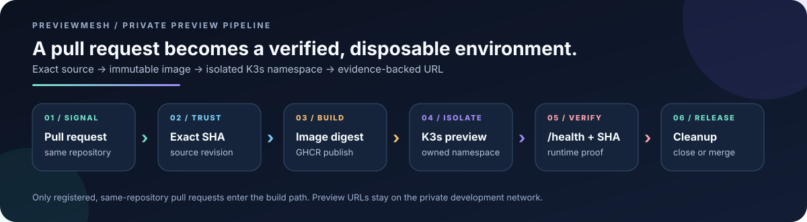

# PreviewMesh

**Private pull-request previews with exact-commit verification, K3s isolation, and automatic cleanup.**

[Features](#features) · [How it works](#how-it-works) · [Install](#install) · [Use a preview](#use-a-preview) · [Troubleshooting](#troubleshooting) · [中文说明](README_CN.md)

PreviewMesh gives every eligible pull request its own temporary preview on your private development network, so product, QA, and business teams can try a change before it merges without waiting for someone to set up a test environment.

Each time a pull request changes, PreviewMesh builds that exact commit, publishes an immutable image, deploys it to K3s, checks that the running app reports the expected commit, and posts the link on the pull request. When the pull request closes, the preview is removed.

> [!WARNING]
> This is the public PreviewMesh code repository. Keep the deployment-management repository created from it private. Never commit GitHub tokens, kubeconfigs, real repository registrations, private URLs, or runtime evidence here.

## Features

- **Exact revisions:** builds the pull request's full commit SHA and deploys the image by immutable digest.
- **Isolated previews:** gives each registered repository and pull request a predictable, owned Kubernetes namespace and release.
- **Trusted eligibility:** checks the registered repository ID and name, the current pull request state, same-repository head and base, and author write access. Fork pull requests are rejected.
- **Runtime verification:** waits for the workload and ingress, then requires HTTP 200 from `/health` with `status: "ok"` and the expected `commit_sha`.
- **Pull-request feedback:** publishes a pending check right away, then the final result and an **Open preview** link once a deployment is verified.
- **Automatic cleanup:** removes the owned preview when a pull request closes or merges, with inspection and bounded retry paths for recovery.

## How it works

PreviewMesh separates three repository roles:

| Repository | Holds | Visibility |
| --- | --- | --- |
| **PreviewMesh code** (this repository) | Reusable Go code, Helm chart, workflows, setup scripts, and documentation. | Public |
| **Deployment management** (also called the control repository) | Trusted workflows, application registrations, Actions secrets, runner configuration, and the control plane. | Private |
| **Application** | Your code, a root `Dockerfile`, `/health`, and the notification workflow. | Public or private |

This repository is the source for creating or updating a deployment-management repository; it is not the control plane itself. Don't enter an application repository as the deployment-management repository.

~~~mermaid
flowchart LR
    A[Open or update PR in application repository] --> B[Notification workflow]
    B -->|Repository ID, name, PR number| C[Private deployment-management workflow]
    C --> D[Validate registration, PR and permissions]
    D --> E[Checkout exact source SHA]
    E --> F[Build and push immutable GHCR digest]
    F --> G[Deploy to K3s on restricted runner]
    G --> H[Verify readiness, /health and served SHA]
    H --> I[Commit status, PR comment and preview URL]
    A2[Close or merge PR] --> J[Remove owned namespace]
~~~

> [!IMPORTANT]
> Keep these trust boundaries in place:
>
> - The notification workflow forwards metadata only. It never checks out or runs pull-request code.
> - Only applications registered in the deployment-management repository are accepted.
> - Preview workflows stay disabled until that repository sets `PREVIEWMESH_ENABLED=true`.
> - The self-hosted runner must use a restricted kubeconfig on a dedicated development cluster, never a cluster-admin one.
> - Preview URLs are for private-network access, not public internet hosting.

## Requirements

**Host:** Ubuntu 22.04 or 24.04 x64, including on WSL2 with systemd. You need:

- a normal Linux user with `sudo` access, plus Windows administrator access on WSL for the LAN entry;
- a dedicated development K3s cluster and a stable private LAN IPv4 address;
- access to the GitHub repositories involved, and an authenticated `gh` CLI when the installer asks for one;
- separate, non-overlapping local directories for the public code, the deployment-management checkout, and each application checkout;
- token files outside any Git checkout, readable only by their owner.

**Application:** each registered application must provide:

| Requirement | Contract |
| --- | --- |
| Image | A root `Dockerfile` that builds for `linux/amd64`. |
| Network | Listens on `0.0.0.0` at its registered HTTP port. |
| Runtime | Compatible with UID/GID `65532`, with no extra Linux capabilities. |
| Health endpoint | `GET /health` returns HTTP 200 and JSON containing `status: "ok"` and the runtime `PREVIEW_COMMIT_SHA`. |

~~~json
{"status":"ok","commit_sha":"the value of PREVIEW_COMMIT_SHA"}
~~~

## Install

The guided installer creates or updates the deployment-management repository and prepares the machine. For a step-by-step alternative, see the [manual installation reference](ops/install/manual.md).

### 1. Create the configuration

~~~bash
git clone https://github.com/flashrick/PreviewMesh.git
cd PreviewMesh
bash scripts/setup.sh init
~~~

The wizard asks for your repositories and local directories, application ports, token file paths, private LAN address, allowed subnet, preview domain suffix, and output language. It saves them to `~/.config/previewmesh/setup.ini`, storing token file paths rather than token values.

To use another location, pass `--config /path/to/setup.ini` to every setup command. Add `--template` to `init` to get a commented template instead of the wizard.

> [!CAUTION]
> If `init` finds an existing installation, it offers a cleanup that runs immediately and can delete local files, including local repository checkouts. Read [Clean up an installation](ops/install/cleanup.md) before choosing a level.

### 2. Install the control plane

~~~bash
bash scripts/setup.sh install
~~~

This prepares the tools, the deployment-management repository, GitHub secrets, K3s permissions, a restricted runner, the preview network entry, the source-notification workflow, and readiness checks. It is resumable: if a stage fails, fix the reported issue and rerun the same command.

It also builds the CLI at `<control checkout>/bin/previewmesh`. That binary belongs to that checkout, so it is not installed globally or added to `PATH`.

### 3. Publish the notification workflow

`install` prepares `.github/workflows/previewmesh-notify.yml` in your local application checkout but never commits, pushes, or merges application changes:

| Existing file | What `install` does |
| --- | --- |
| None | Creates it. |
| Current template | Leaves it unchanged. |
| Recognized current or older template that needs new values, or a version the installer managed | Upgrades it and saves the old content as `previewmesh-notify.yml.previewmesh.bak`. |
| Custom workflow | Keeps it and writes `previewmesh-notify.yml.previewmesh-proposed` and `previewmesh-notify.yml.previewmesh.patch` for review. The install stage still succeeds. |

For a custom workflow, review the proposed file and patch, keep any logic you want in the tracked workflow, and publish that. The `.previewmesh.bak`, `.previewmesh-proposed`, and `.previewmesh.patch` files are local review artifacts, so don't commit them unless you mean to keep them.

Inspect the workflow, then publish it from the application checkout:

~~~bash
cd /path/to/application-checkout
git status --short
git diff -- .github/workflows/previewmesh-notify.yml
git add -- .github/workflows/previewmesh-notify.yml
git diff --cached
git diff --cached --check
git commit -m "Update PreviewMesh source notification"
git push origin HEAD
~~~

`git add` names only the workflow, so review artifacts aren't staged. `git push origin HEAD` publishes directly only when you're on the application's default branch; otherwise, follow that repository's policy and open or update a pull request.

Prefer a generated onboarding pull request?

`onboard-source` is an optional alternative. By default it only prints the complete proposed change. After reviewing it, add `--create-pr` to open a pull request:

~~~bash
bash scripts/setup.sh onboard-source --source OWNER/REPO
bash scripts/setup.sh onboard-source --source OWNER/REPO --create-pr
~~~

It submits only the notification workflow and doesn't merge the pull request or change other application code. Merge it on the default branch before creating a test preview.

### 4. Create your first preview

1. Open a pull request from a branch in the registered application repository to its default branch. Don't use a fork.
2. Wait for the deployment-management workflow to finish. The `PreviewMesh` check shows that the request is waiting as soon as the notification workflow succeeds.
3. Confirm the build, deployment, readiness, health, and commit checks succeed.
4. Open the generated URL from a machine on the private network. The [preview access guide](ops/install/access.md) covers DNS, hosts files, WSL, port `18080`, and `/health` checks.
5. Close or merge the pull request. The pull request shows that cleanup is in progress, and the URL may keep working briefly until the namespace removal is confirmed.

> [!NOTE]
> The installer and its checks prepare infrastructure, but only a first real pull request proves the whole path. `check`, `doctor`, and the preflight don't prove a cluster deployment, ingress reachability, or application tests.

## Use a preview

~~~text
push a branch -> open a same-repository PR -> wait for deployment -> review the private URL -> close or merge -> confirm cleanup
~~~

Deployment is asynchronous. A successful notification or a `pending` or `queued` check only means the request was accepted, so wait for the status to become `ready` before opening the URL. The wait depends on workflow queueing, image build and pull, K3s scheduling, and `/health` verification. The CLI's defaults of five minutes per external operation and one minute for HTTP verification are safety limits, not a deployment estimate.

Inspect previews with the CLI from your deployment-management checkout:

~~~bash
CONTROL_DIR=/path/to/previewmesh-control
"$CONTROL_DIR/bin/previewmesh" ps
"$CONTROL_DIR/bin/previewmesh" inspect 123
"$CONTROL_DIR/bin/previewmesh" health 123
"$CONTROL_DIR/bin/previewmesh" status --repo OWNER/REPO --pr 123
~~~

| Command | Source | What it tells you |
| --- | --- | --- |
| `ps` | Kubernetes | Live runtime state and URLs. Add `--all` to include previews from other control repositories. |
| `inspect TARGET` | Kubernetes and GitHub | Runtime details together with lifecycle evidence. |
| `health TARGET` | Live HTTP request | The current `/health` response. A healthy response alone doesn't prove the lifecycle is `ready`. |
| `status --repo OWNER/REPO --pr N` | GitHub, through `gh` | `ready` from complete, recent evidence for the current commit, or `removed` from cleanup evidence. It doesn't probe the URL or query Kubernetes. |
| `rm TARGET` | Kubernetes | Removes one owned preview namespace after confirmation (`--yes` skips the prompt). An open pull request also requires `--force`. The pull request itself is never changed. |

`TARGET` can be a pull request number, `source#PR`, `owner/name#PR`, or a preview name. Add `--json` for scripts.

Advanced: direct CLI lifecycle

The deployment-management workflow is the recommended path because it rechecks pull-request state and handles superseded revisions and cleanup. These lower-level commands are for trusted control environments. Build both tools into the control checkout:

~~~bash
CONTROL_DIR=/path/to/previewmesh-control
go build -o "$CONTROL_DIR/bin/control" ./cmd/control
go build -o "$CONTROL_DIR/bin/previewmesh" ./cmd/previewmesh
~~~

| Command | Purpose |
| --- | --- |
| `control resolve` | Resolve one exact repository registration. |
| `control inspect` | Validate the pull request, source repository, fork status, and author access. |
| `control status` | Publish commit status and structured pull-request feedback. |
| `previewmesh preflight` | Inspect an application checkout and optionally run a temporary local container. |
| `previewmesh build` | Validate the exact checkout and publish an image for the control workflow. |
| `previewmesh deploy` | Deploy an immutable image digest to an owned preview namespace. |
| `previewmesh verify` | Wait for readiness and verify `/health` and the served revision. |
| `previewmesh cleanup` | Remove an owned preview after a pull request closes. |
| `previewmesh cleanup-inspect` | Collect ownership and cleanup state without deleting resources. |
| `previewmesh cleanup-retry` | Retry cleanup using the original namespace identity. |

Run `previewmesh <command> --help` for exact flags. Never pass private credentials through public documentation or shell history.

## Troubleshooting

Start with the read-only setup checks. `check` validates the configuration and prerequisites, and `doctor` inspects installed services, credentials, DNS, GitHub setup, and pending onboarding work:

~~~bash
bash scripts/setup.sh check
bash scripts/setup.sh doctor
~~~

| Symptom | First checks |
| --- | --- |
| No application notification | Confirm the workflow is on the application's default branch, Actions is enabled, and the onboarding pull request was merged. Fork pull requests are intentionally skipped. |
| Deployment jobs are skipped | Set `PREVIEWMESH_ENABLED=true` in the deployment-management repository and dispatch its `main` workflow. |
| The `local` job stays queued | Check that the self-hosted runner is online with the `self-hosted`, `Linux`, `X64`, and `previewmesh` labels. |
| Registration or authorization fails | Compare the registered repository ID and owner/name. The pull request must be in that repository and its author must have write access. |
| Image push or pull fails | Check GitHub package write access for the build workflow, `GHCR_READ_TOKEN`, and the `ghcr-pull` secret in the preview namespace. |
| A check stays `pending` or `queued` | Inspect the control workflow and keep waiting. These states don't mean the preview failed. |
| A check becomes `failure` | Read the failed stage and its workflow log before retrying. A timeout doesn't prove the application is unhealthy. |
| Readiness or HTTP verification fails | Check the Deployment, Pod, Service, Traefik, the configured hostname, and the `/health` response. See the [preview access guide](ops/install/access.md). |
| `status` has no usable URL | Evidence may be pending, failed, expired, or from an older commit. Inspect the latest workflow and rerun the preview. |
| A preview remains after closing | The cleanup-in-progress comment explains the short transition. If dispatch failed, fix it and manually retry the cleanup path. |
| WSL access stops working | Rerun `init` to confirm the current Windows host LAN address, then rerun `install`. See the [preview access guide](ops/install/access.md). |

### Where configuration and credentials live

| Location | Purpose | Handling |
| --- | --- | --- |
| PreviewMesh checkout | Reusable code, charts, workflows, templates, and safe examples. | Public. Never add real registrations, credentials, or runtime evidence. |
| Deployment-management checkout | Trusted workflows and `config/repositories.json` registrations. | Private. Commit registrations only here. |
| `~/.config/previewmesh/setup.ini` | Per-user repository, directory, network, port, and token-path settings. | Outside Git and owner-readable. Holds references, not token contents. |
| `~/.local/share/previewmesh/install-state.json` | Per-account installation checkpoints and ownership state. | Outside Git and owner-readable. Don't delete it to bypass a control-repository mismatch. |
| Token files | Application, dispatch, and GHCR credentials. | Outside Git with owner-only permissions. |

The application workflow uses `PREVIEWMESH_DISPATCH_TOKEN` to notify the deployment-management repository, which stores the source-repository secrets and `GHCR_READ_TOKEN`. The installer explains the required scopes and destinations.

## Update and clean up

- **Update:** [Update a private deployment-management checkout](ops/install/upgrade.md) describes two paths: a generated review branch and pull request (`scripts/update-upstream.sh`), or a validated direct push to `main` (`scripts/sync-previewmesh.sh`). Choose one per update. Both preserve your application registrations.
- **Clean up:** [Clean up an installation](ops/install/cleanup.md) explains the three cumulative levels of `bash scripts/setup.sh cleanup`. Preview the plan first with `--dry-run`, and choose the highest level you need in one run.

## Development

Run the canonical local verification from this checkout. It needs `git`, Go 1.25+, `python3` with PyYAML, Helm 3, and `actionlint`, but no access to GitHub, GHCR, K3s, the private network, or application credentials, and it doesn't deploy anything:

~~~bash
bash scripts/verify-local.sh
~~~

It covers the Go code, workflow and setup fixtures, Python validation, Bash syntax, the Helm chart, and workflow syntax. For focused checks, run `go test ./...`, `go vet ./...`, or `helm lint charts/preview`.

| Path | Responsibility |
| --- | --- |
| [`cmd/previewmesh/`](cmd/previewmesh/) | Lifecycle CLI for preflight, build, deploy, verify, status, and cleanup. |
| [`cmd/control/`](cmd/control/) | Trusted repository registration, pull-request inspection, and GitHub reporting. |
| [`.github/workflows/preview.yml`](.github/workflows/preview.yml) | Control-plane workflow that builds, deploys, verifies, and reports a preview. |
| [`templates/source-notify.yml`](templates/source-notify.yml) | Metadata-only application workflow that notifies the control repository. |
| [`charts/preview/`](charts/preview/) | Helm chart for the preview Deployment, Service, Ingress, and namespace-scoped identity. |
| [`scripts/`](scripts/) | Guided setup, onboarding, maintenance, evidence, and local verification tools. |
| [`ops/kubernetes/`](ops/kubernetes/) | Restricted runner RBAC and Traefik configuration for the development cluster. |

## Documentation

- [Preview access](ops/install/access.md): DNS, hosts files, WSL/LAN access, port `18080`, and `/health` verification.
- [Manual installation](ops/install/manual.md): infrastructure setup when the guided installer isn't suitable.
- [Update a deployment-management checkout](ops/install/upgrade.md): review-branch and direct-sync upgrades.
- [Clean up an installation](ops/install/cleanup.md): cleanup levels and optional remote and cluster removal.
- [Kubernetes runner access](ops/kubernetes/README.md): restricted kubeconfig and RBAC boundary.
- [Preview lifecycle verification](ops/verification/preview-lifecycle.md): operational lifecycle and cleanup checks.
