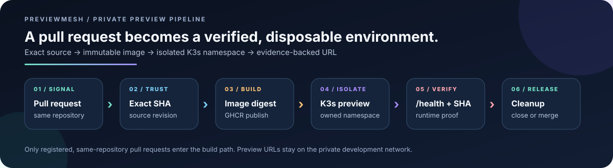

# PreviewMesh

  
<strong>Private pull-request previews with exact-commit verification, K3s isolation, and automatic cleanup.</strong>

  

    <a href="README_CN.md">中文说明</a> ·
    <a href="#quick-start">Quick start</a> ·
    <a href="#how-it-works">How it works</a> ·
    <a href="#verify-a-change">Verify a change</a>
  

  

    
    
    
  

  

PreviewMesh creates a temporary application URL on a private development network for eligible pull requests. It builds the exact source commit, publishes an immutable image, deploys it to K3s, verifies `/health` and the served commit SHA, reports the result to the pull request, and removes the preview when the pull request closes.

> [!WARNING]
> This is the public PreviewMesh code repository. Keep the deployment-management repository created from it private. Never commit GitHub tokens, kubeconfigs, real repository registrations, private URLs, or runtime evidence here.

## Quick links

- [Quick start](#quick-start)
- [What you get](#what-you-get)
- [How it works](#how-it-works)
- [Project map](#project-map)
- [Requirements](#requirements)
- [Install](#install)
- [Use a preview](#use-a-preview)
- [Operate and troubleshoot](#operate-and-troubleshoot)
- [Verify a change](#verify-a-change)
- [Advanced reference](#advanced-reference)
- [Related documentation](#related-documentation)

## Quick start

Use the guided installer to create or update the private deployment-management checkout. Run it from this public PreviewMesh checkout:

~~~bash
bash scripts/setup.sh init
bash scripts/setup.sh install --config /path/to/setup.ini
~~~

Keep the public checkout, private deployment-management checkout, and application checkout in separate directories. If you are evaluating a change rather than installing infrastructure, run [Verify a change](#verify-a-change) instead.

## What you get

| Capability | Behavior |
| --- | --- |
| Exact revisions | Builds the pull request's full commit SHA and deploys the resulting image by immutable digest. |
| Isolated previews | Creates a predictable, owned Kubernetes namespace and release for each registered repository and pull request. |
| Trusted eligibility | Checks the registered repository ID and name, current pull request state, same-repository head and base, and author write access. Fork pull requests are rejected. |
| Runtime verification | Waits for the workload and ingress, then requires HTTP 200 with `status: "ok"` and the expected `commit_sha` from `/health`. |
| Pull-request feedback | Publishes a commit status, a result comment when permitted, and an **Open preview** URL for a verified deployment. |
| Cleanup | Removes the owned preview after a pull request closes or merges, with inspection and bounded retry paths for recovery. |

## How it works

PreviewMesh uses three separate repository roles:

| Repository role | Responsibility | Visibility |
| --- | --- | --- |
| PreviewMesh code repository | Reusable Go code, Helm chart, workflows, setup scripts, and public documentation. | Public |
| Deployment-management repository | Trusted workflows, application registrations, Actions secrets, runner configuration, and the private control plane. | Private |
| Application repository | Application code, a root `Dockerfile`, `/health`, and the notification workflow. | Public or private |

The public repository is source code for creating or updating a private deployment-management repository. It is not the control plane, and an application repository must not be entered as the deployment-management repository.

~~~mermaid
flowchart LR
    A[Open or update PR in application repository] --> B[Notification workflow]
    B -->|Repository ID, name, PR number| C[Private deployment-management workflow]
    C --> D[Validate registration, PR and permissions]
    D --> E[Checkout exact source SHA]
    E --> F[Build and push immutable GHCR digest]
    F --> G[Deploy to K3s on restricted runner]
    G --> H[Verify readiness, /health and served SHA]
    H --> I[Commit status, PR comment and preview URL]
    A2[Close or merge PR] --> J[Remove owned namespace]
~~~

Important boundaries:

- The source notification workflow forwards metadata only; it does not check out or execute pull-request code.
- Only applications registered in the private deployment-management repository are accepted.
- Preview workflows remain disabled until the private repository sets `PREVIEWMESH_ENABLED=true`.
- The self-hosted runner must use a restricted kubeconfig on a dedicated development cluster. Do not give it a cluster-admin kubeconfig.
- The preview URL is private-network access, not public internet hosting.

## Project map

| Path | Responsibility |
| --- | --- |
| [`cmd/previewmesh/`](cmd/previewmesh/) | Lifecycle CLI for preflight, build, deploy, verify, status, and cleanup. |
| [`cmd/control/`](cmd/control/) | Trusted repository registration, pull-request inspection, and GitHub reporting. |
| [`.github/workflows/preview.yml`](.github/workflows/preview.yml) | Control-plane workflow that builds, deploys, verifies, and reports a preview. |
| [`templates/source-notify.yml`](templates/source-notify.yml) | Metadata-only application workflow that notifies the private control repository. |
| [`charts/preview/`](charts/preview/) | Helm chart for the preview Deployment, Service, Ingress, and namespace-scoped identity. |
| [`scripts/`](scripts/) | Guided setup, onboarding, maintenance, evidence, and local verification tools. |
| [`ops/kubernetes/`](ops/kubernetes/) | Restricted runner RBAC and Traefik configuration for the development cluster. |

## Requirements

The guided installer supports **Ubuntu 22.04 or 24.04 x64**, including those distributions on **WSL2 with systemd**. Use a normal Linux user with `sudo` access, a dedicated development K3s cluster, and a stable private LAN IPv4 address. WSL installations also require Windows administrator access for the LAN entry.

You will need:

- access to the GitHub repositories involved in the installation;
- an authenticated `gh` CLI session when the installer or onboarding flow requests it;
- separate local directories for the public code, private deployment-management checkout, and each application checkout;
- token files outside Git checkouts, protected so only the owning user can read them.

### Application contract

Each registered application must provide:

| Requirement | Contract |
| --- | --- |
| Image | A root `Dockerfile` that builds for `linux/amd64`. |
| Network | The application listens on `0.0.0.0` at its registered HTTP port. |
| Runtime | The image is compatible with UID/GID `65532` and does not require extra Linux capabilities. |
| Health endpoint | `GET /health` returns HTTP 200 and JSON containing `status: "ok"` and the runtime `PREVIEW_COMMIT_SHA`. |

For example:

~~~json
{"status":"ok","commit_sha":"the value of PREVIEW_COMMIT_SHA"}
~~~

The preflight can inspect the Dockerfile and optionally run a temporary local container. Those checks do not prove a cluster deployment, ingress reachability, or application-level tests. The first real pull request verifies the complete path.

## Install

Run the following from the public PreviewMesh checkout. The public checkout, private deployment-management checkout, and application checkouts must not overlap.

### 1. Create the configuration

The wizard stores the active configuration at `~/.config/previewmesh/setup.ini` by default. It stores token file paths, not token values.

~~~bash
bash scripts/setup.sh init
~~~

To use another location, pass it explicitly:

~~~bash
bash scripts/setup.sh init --config /path/to/setup.ini
~~~

The wizard asks for the private deployment-management repository, its local checkout, the public PreviewMesh repository, application repositories and ports, token file paths, the private LAN address, the allowed subnet, the preview domain suffix, and the output language. Keep all repository roles and local directories separate.

If you need a commented template without starting the interactive flow:

~~~bash
bash scripts/setup.sh init --template --config /path/to/setup.ini
~~~

Do not put a filled-in configuration or token values in this repository.

### 2. Install the control plane

~~~bash
bash scripts/setup.sh install --config /path/to/setup.ini
~~~

`install` prepares the tools, private deployment-management repository, GitHub secrets, K3s permissions, restricted runner, preview network entry, source-notification integration, and readiness checks. It is resumable; when a stage fails, fix the reported issue and rerun the same command.

The installer prepares infrastructure. It does not rewrite application code or prove that an application can serve its preview. The [manual installation reference](ops/install/manual.md) explains each infrastructure step when the guided path is not suitable.

### 3. Onboard an application with a reviewed PR

Preview the workflow change without writing to the application repository:

~~~bash
bash scripts/setup.sh onboard-source --config /path/to/setup.ini --source OWNER/REPO
~~~

After reviewing the complete diff, add `--create-pr` to create a dedicated, reviewable onboarding pull request:

~~~bash
bash scripts/setup.sh onboard-source --config /path/to/setup.ini --source OWNER/REPO --create-pr
~~~

The command prepares only `.github/workflows/previewmesh-notify.yml`. It does not merge the PR or modify application code. Merge the reviewed PR on the application's default branch before creating a test preview.

### 4. Create the first preview

1. Create a normal pull request from a branch in the registered application repository to its default branch. Do not use a fork.
2. Wait for the application notification workflow and the private deployment-management workflow.
3. Confirm the build, deployment, readiness, health, and commit-revision checks succeed.
4. Open the generated URL from a machine that can reach the configured private network. Follow the [preview access guide](ops/install/access.md) for DNS, hosts-file, WSL, port `18080`, and `/health` checks.
5. Close or merge the pull request and wait for the cleanup workflow to remove its preview namespace.

## Use a preview

The normal development loop is:

~~~text
push a branch -> open a same-repository PR -> wait for deployment -> review the private URL -> close or merge -> confirm cleanup
~~~

To inspect a preview from the private deployment-management checkout, build the read-only status command:

~~~bash
go build -o /tmp/previewmesh ./cmd/previewmesh
gh auth status
/tmp/previewmesh status --repo OWNER/REPO --pr 123
~~~

For automation-friendly output:

~~~bash
/tmp/previewmesh status --repo OWNER/REPO --pr 123 --json
~~~

`status` reads the current pull-request state, `PreviewMesh` commit status, and structured workflow feedback through the authenticated `gh` CLI. It does not probe the preview URL, query Kubernetes, or perform a live health check. A `ready` result is based on complete, recent evidence for the current commit; after closure, `removed` confirms cleanup evidence.

HTTP 200 alone is not enough. A successful application verification also requires `status: ok` and a `commit_sha` matching the exact source revision requested for that run.

## Operate and troubleshoot

### Check and resume

These setup commands are read-only checks:

~~~bash
# Read configuration and inspect prerequisites.
bash scripts/setup.sh check --config /path/to/setup.ini

# Inspect installed services, credentials, DNS and GitHub setup.
bash scripts/setup.sh doctor --config /path/to/setup.ini
~~~

`--config` is a setup-script option. It selects the setup configuration; it does not create a separate installation state. `doctor` reports infrastructure readiness and pending onboarding work, but neither `check` nor `doctor` proves a successful application preview.

If an old installation must be reset, use the selective cleanup menu and review every destructive category before confirming:

~~~bash
bash scripts/setup.sh cleanup --config /path/to/setup.ini
~~~

### Configuration and credential boundaries

| Location | Purpose | Handling |
| --- | --- | --- |
| Public PreviewMesh checkout | Reusable code, charts, workflows, templates, and safe examples. | Public; never add real registrations, credentials, or runtime evidence. |
| Private deployment-management checkout | Trusted workflows and `config/repositories.json` registrations. | Keep private and commit registrations only there. |
| `~/.config/previewmesh/setup.ini` | Per-user repository, directory, network, port, and token-path settings. | Keep outside Git and owner-readable; it stores references, not token contents. |
| `~/.local/share/previewmesh/install-state.json` | Per-account installation checkpoints and ownership state. | Keep outside Git and owner-readable; do not delete it to bypass a control-repository mismatch. |
| Token files | Application, dispatch, and GHCR credentials. | Keep outside Git with owner-only permissions. |

The application workflow uses `PREVIEWMESH_DISPATCH_TOKEN` to notify the private deployment-management repository. The private repository stores source-repository secrets and `GHCR_READ_TOKEN`. The installer explains the required scopes and destinations; never copy those values into this public checkout.

### Troubleshooting

| Symptom | First checks |
| --- | --- |
| No application notification | Confirm the workflow is on the application default branch, Actions is enabled, and the onboarding PR was merged. Fork PRs are intentionally skipped. |
| Deployment jobs are skipped | Set `PREVIEWMESH_ENABLED=true` in the private deployment-management repository and dispatch its `main` workflow. |
| The `local` job stays queued | Check that the private repository's self-hosted runner is online and has `self-hosted`, `Linux`, `X64`, and `previewmesh` labels. |
| Registration or authorization fails | Compare the private registration's repository ID and owner/name. The PR must be in that repository and its author must have write access. |
| Image push or pull fails | Check GitHub package write access for the build workflow, `GHCR_READ_TOKEN`, and the `ghcr-pull` Secret used by the preview namespace. |
| Readiness or HTTP verification fails | Check Deployment, Pod, Service, Traefik, the configured hostname, and the `/health` response. Use the [preview access guide](ops/install/access.md). |
| `status` has no usable URL | Evidence may be pending, failed, expired, or associated with an older commit. Inspect the latest workflow and rerun the preview. `status` does not probe the URL. |
| A preview remains after PR closure | Wait for the closed-PR notification and control workflow. If dispatch failed, fix it and manually retry the cleanup path. |
| WSL access stops working | Rerun `init` to confirm the current Windows host LAN address, then rerun `install`. Review the [manual WSL and access guidance](ops/install/access.md). |

For runner permissions, see [Kubernetes access](ops/kubernetes/README.md). For a full manual setup, see [manual installation](ops/install/manual.md). For lifecycle and recovery details, see [preview lifecycle verification](ops/verification/preview-lifecycle.md).

## Verify a change

Run the repository's canonical local verification from the public checkout:

~~~bash
bash scripts/verify-local.sh
~~~

It checks the Go code, workflow and setup fixtures, Python validation, Bash syntax, the Helm chart, and GitHub Actions workflow syntax. It does not deploy an application or require access to GitHub, GHCR, K3s, the private network, or application credentials.

For focused checks, use:

~~~bash
go test ./...
go vet ./...
helm lint charts/preview
~~~

## Advanced reference

Direct CLI lifecycle

The private deployment-management workflow is the recommended path because it rechecks pull-request state and handles superseded revisions and cleanup. The lower-level CLI commands are available for trusted control environments:

Build both trusted command-line tools with:

~~~bash
go build -o /tmp/control ./cmd/control
go build -o /tmp/previewmesh ./cmd/previewmesh
~~~

The companion `control` CLI validates trusted registrations and pull-request state before reporting to GitHub:

| Command | Purpose |
| --- | --- |
| `control resolve` | Resolve one exact repository registration. |
| `control inspect` | Validate the pull request, source repository, fork status, and author access. |
| `control status` | Publish commit status and structured pull-request feedback. |

The `previewmesh` CLI owns the deployment lifecycle:

| Command | Purpose |
| --- | --- |
| `preflight` | Inspect an application checkout and optionally run a temporary local container check. |
| `build` | Validate the exact checkout and publish an image for the control workflow. |
| `deploy` | Deploy an immutable image digest to an owned preview namespace. |
| `verify` | Wait for readiness and verify `/health` and the served revision. |
| `cleanup` | Remove an owned preview after a pull request closes. |
| `cleanup-inspect` | Collect ownership and cleanup state without deleting resources. |
| `cleanup-retry` | Retry cleanup using the original namespace identity. |

Use `previewmesh <command> --help` in the private control checkout for the exact flags. Never pass private credentials through public documentation or shell history.

Update a private deployment-management checkout

Run updates from the private checkout, not this public source directory. Review or stash local changes first:

~~~bash
git switch main
git pull --ff-only origin main
git status --short
scripts/update-upstream.sh --remote upstream --ref main
~~~

Review the update branch and run local verification before pushing it or opening a pull request. The updater preserves the private repository's application registrations and does not update already-published application notification workflows automatically. Rerun `install` after merging an update when local managed files need refreshing.

## Related documentation

- [Preview access](ops/install/access.md) — DNS, hosts files, WSL/LAN access, port `18080`, and `/health` verification.
- [Manual installation](ops/install/manual.md) — infrastructure setup when the guided installer is not suitable.
- [Kubernetes runner access](ops/kubernetes/README.md) — restricted kubeconfig and RBAC boundary.
- [Preview lifecycle verification](ops/verification/preview-lifecycle.md) — operational lifecycle and cleanup checks.
