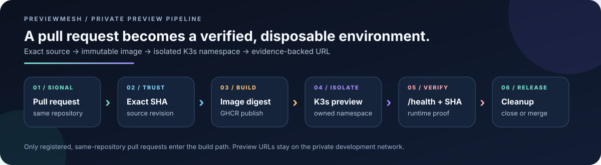

# PreviewMesh

**面向拉取请求的私有预览：精确提交验证、K3s 隔离和自动清理。**

[功能特性](#功能特性) · [工作原理](#工作原理) · [安装](#安装) · [使用预览](#使用预览) · [故障排查](#故障排查) · [English](README.md)

PreviewMesh 为每个符合条件的拉取请求（PR）在私有开发网络中提供一个临时预览环境，让产品、测试和业务同学无需等待人工搭建测试环境，就能在合并前体验改动。

PR 每次更新时，PreviewMesh 都会构建对应的准确提交，发布不可变镜像，部署到 K3s，确认运行中的应用返回预期的提交版本，并把链接发布到 PR 上。PR 关闭后，预览会被自动删除。

> [!WARNING]
> 这是公开的 PreviewMesh 代码仓库。由它创建的部署管理仓库必须保持私有。不要在这里提交 GitHub Token、kubeconfig、真实仓库注册信息、私有 URL 或运行时证据。

## 功能特性

- **准确版本：** 构建 PR 的完整提交 SHA，并使用不可变镜像摘要部署。
- **隔离预览：** 为每个已注册仓库和 PR 创建可预测、带所有权标记的 Kubernetes Namespace 和 Release。
- **可信准入：** 校验已注册的仓库 ID 和名称、当前 PR 状态、同一仓库的 head/base，以及作者的写权限。Fork PR 会被拒绝。
- **运行时验证：** 等待工作负载和 Ingress 就绪，然后要求 `/health` 返回 HTTP 200、`status: "ok"` 和预期的 `commit_sha`。
- **PR 反馈：** 立即写入 pending 检查，部署验证成功后再写入最终结果和 **Open preview** 链接。
- **自动清理：** PR 关闭或合并后删除所属预览，并提供检查和有限重试路径用于恢复。

## 工作原理

PreviewMesh 区分三类仓库角色：

| 仓库 | 内容 | 可见性 |
| --- | --- | --- |
| **PreviewMesh 代码**（本仓库） | 可复用 Go 代码、Helm Chart、工作流、安装脚本和文档。 | 公开 |
| **部署管理**（也称控制仓库） | 可信工作流、应用注册信息、Actions Secrets、Runner 配置和控制平面。 | 私有 |
| **应用** | 你的代码、根目录的 `Dockerfile`、`/health` 和通知工作流。 | 公开或私有 |

本仓库是创建或更新部署管理仓库的代码来源，本身不是控制平面。不要把应用仓库填写为部署管理仓库。

~~~mermaid
flowchart LR
    A[在应用仓库中创建或更新 PR] --> B[通知工作流]
    B -->|仓库 ID、名称、PR 编号| C[私有部署管理工作流]
    C --> D[校验注册信息、PR 和权限]
    D --> E[检出准确的源代码 SHA]
    E --> F[构建并推送不可变 GHCR 摘要]
    F --> G[在受限 Runner 上部署到 K3s]
    G --> H[验证就绪、/health 和返回的 SHA]
    H --> I[Commit Status、PR 评论和预览 URL]
    A2[关闭或合并 PR] --> J[删除所属 Namespace]
~~~

> [!IMPORTANT]
> 请保持以下信任边界：
>
> - 通知工作流只转发元数据，不会检出或执行 PR 代码。
> - 只接受在部署管理仓库中注册的应用。
> - 该仓库设置 `PREVIEWMESH_ENABLED=true` 之前，预览工作流保持禁用。
> - 自托管 Runner 必须在专用开发集群中使用受限 kubeconfig，不能使用 cluster-admin kubeconfig。
> - 预览 URL 只能从私有网络访问，不是公开互联网托管。

## 前置条件

**主机：** Ubuntu 22.04 或 24.04 x64，包括运行在 WSL2 systemd 上的这些发行版。你需要：

- 有 `sudo` 权限的普通 Linux 用户；WSL 还需要 Windows 管理员权限来配置局域网入口；
- 专用开发 K3s 集群和稳定的私有局域网 IPv4 地址；
- 能访问安装涉及的 GitHub 仓库，并在安装器要求时使用已认证的 `gh` CLI；
- 为公开代码、部署管理 checkout 和每个应用 checkout 准备互不重叠的本地目录；
- 将 Token 文件放在所有 Git checkout 之外，并限制为仅所有者可读。

**应用：** 每个已注册应用都必须提供：

| 要求 | 契约 |
| --- | --- |
| 镜像 | 根目录中的 `Dockerfile`，并能构建 `linux/amd64` 镜像。 |
| 网络 | 在注册的 HTTP 端口上监听 `0.0.0.0`。 |
| 运行时 | 兼容 UID/GID `65532`，不依赖额外的 Linux capability。 |
| 健康接口 | `GET /health` 返回 HTTP 200，并在 JSON 中包含 `status: "ok"` 和运行时的 `PREVIEW_COMMIT_SHA`。 |

~~~json
{"status":"ok","commit_sha":"the value of PREVIEW_COMMIT_SHA"}
~~~

## 安装

引导式安装器会创建或更新部署管理仓库，并准备好本机环境。如需逐步操作，请看[手动安装参考](ops/install/manual_CN.md)。

### 1. 创建配置

~~~bash
git clone https://github.com/flashrick/PreviewMesh.git
cd PreviewMesh
bash scripts/setup.sh init
~~~

向导会询问你的仓库和本地目录、应用端口、Token 文件路径、私有局域网地址、允许网段、预览域名后缀和输出语言，并保存到 `~/.config/previewmesh/setup.ini`。其中只保存 Token 文件路径，不保存 Token 内容。

如需使用其他路径，请为每条 setup 命令加上 `--config /path/to/setup.ini`。给 `init` 加上 `--template` 可以获得带注释的模板，而不启动向导。

> [!CAUTION]
> 如果 `init` 检测到已有安装，会提供一个立即执行的清理选项，可能删除本地文件，包括本地仓库 checkout。选择级别前请先阅读[清理安装](ops/install/cleanup_CN.md)。

### 2. 安装控制平面

~~~bash
bash scripts/setup.sh install
~~~

该命令会准备工具、部署管理仓库、GitHub Secrets、K3s 权限、受限 Runner、预览网络入口、应用通知工作流和就绪检查。安装支持断点续跑：某个阶段失败时，修复提示的问题后重新运行同一条命令。

它还会在 `<control checkout>/bin/previewmesh` 构建 CLI。该二进制文件只属于这个 checkout，不会全局安装，也不会加入 `PATH`。

### 3. 发布通知工作流

`install` 会在本地应用 checkout 中准备 `.github/workflows/previewmesh-notify.yml`，但不会提交、推送或合并应用改动：

| 已有文件 | `install` 的处理 |
| --- | --- |
| 不存在 | 创建该文件。 |
| 当前模板 | 保持不变。 |
| 需要更新配置值的可识别当前或历史模板，或此前由安装器管理的版本 | 自动升级，并把旧内容保存为 `previewmesh-notify.yml.previewmesh.bak`。 |
| 自定义工作流 | 保留原文件，并生成 `previewmesh-notify.yml.previewmesh-proposed` 和 `previewmesh-notify.yml.previewmesh.patch` 供审核。安装阶段仍会成功。 |

对于自定义工作流，请审核 proposed 文件和 patch，把想保留的逻辑写入受 Git 管理的工作流，然后发布。`.previewmesh.bak`、`.previewmesh-proposed` 和 `.previewmesh.patch` 是本地审核产物，除非有意保留，否则不要提交。

检查工作流后，在应用 checkout 中发布：

~~~bash
cd /path/to/application-checkout
git status --short
git diff -- .github/workflows/previewmesh-notify.yml
git add -- .github/workflows/previewmesh-notify.yml
git diff --cached
git diff --cached --check
git commit -m "Update PreviewMesh source notification"
git push origin HEAD
~~~

`git add` 只指定工作流文件，不会暂存审核产物。只有当前分支是应用的默认分支时，`git push origin HEAD` 才会直接发布；否则请遵循该仓库的策略，创建或更新 PR。

希望自动生成接入 PR？

`onboard-source` 是可选的替代方式。默认只输出完整的待提交变更。审核后，添加 `--create-pr` 创建 PR：

~~~bash
bash scripts/setup.sh onboard-source --source OWNER/REPO
bash scripts/setup.sh onboard-source --source OWNER/REPO --create-pr
~~~

它只提交通知工作流，不会合并 PR，也不会修改其他应用代码。请在创建测试预览前将它合并到默认分支。

### 4. 创建第一个预览

1. 在已注册的应用仓库中从分支创建 PR，目标为默认分支。不要使用 fork。
2. 等待部署管理工作流完成。通知工作流成功后，`PreviewMesh` 检查会立即显示请求正在等待。
3. 确认构建、部署、就绪、健康检查和提交校验均成功。
4. 在私有网络内的机器上打开生成的 URL。[预览访问说明](ops/install/access.md)涵盖 DNS、hosts 文件、WSL、`18080` 端口和 `/health` 检查。
5. 关闭或合并 PR。PR 会显示清理正在进行；确认 Namespace 删除前，URL 可能短暂保持可访问。

> [!NOTE]
> 安装器及其检查只负责准备基础设施，只有第一个真实 PR 才能验证完整链路。`check`、`doctor` 和预检都不能证明集群部署、Ingress 可达性或应用测试通过。

## 使用预览

~~~text
推送分支 -> 创建同仓库 PR -> 等待部署 -> 查看私有 URL -> 关闭或合并 -> 确认清理
~~~

部署是异步的。通知成功或检查处于 `pending`、`queued` 状态只表示请求已被接受，请等状态变为 `ready` 后再打开 URL。等待时间取决于工作流排队、镜像构建和拉取、K3s 调度以及 `/health` 验证。CLI 默认的单次外部操作五分钟和 HTTP 验证一分钟都是安全上限，不是部署耗时估算。

在部署管理 checkout 中使用 CLI 查看预览：

~~~bash
CONTROL_DIR=/path/to/previewmesh-control
"$CONTROL_DIR/bin/previewmesh" ps
"$CONTROL_DIR/bin/previewmesh" inspect 123
"$CONTROL_DIR/bin/previewmesh" health 123
"$CONTROL_DIR/bin/previewmesh" status --repo OWNER/REPO --pr 123
~~~

| 命令 | 数据来源 | 说明 |
| --- | --- | --- |
| `ps` | Kubernetes | 实时运行状态和 URL。加 `--all` 可包含其他控制仓库的预览。 |
| `inspect TARGET` | Kubernetes 和 GitHub | 运行时详情和生命周期证据。 |
| `health TARGET` | 实时 HTTP 请求 | 当前的 `/health` 响应。响应健康本身不能证明生命周期已 `ready`。 |
| `status --repo OWNER/REPO --pr N` | GitHub（通过 `gh`） | `ready` 表示当前提交有完整且较新的证据，`removed` 表示已有清理证据。它不探测 URL，也不查询 Kubernetes。 |
| `rm TARGET` | Kubernetes | 确认后删除一个所属预览 Namespace（`--yes` 跳过确认）。开放的 PR 还需要 `--force`。不会修改 PR 本身。 |

`TARGET` 可以是 PR 编号、`source#PR`、`owner/name#PR` 或预览名称。脚本可以加 `--json`。

高级：直接 CLI 生命周期

推荐使用部署管理工作流，因为它会重新检查 PR 状态，并处理过时版本和清理。下面的底层命令供受信任的控制环境使用。将两个工具构建到控制 checkout：

~~~bash
CONTROL_DIR=/path/to/previewmesh-control
go build -o "$CONTROL_DIR/bin/control" ./cmd/control
go build -o "$CONTROL_DIR/bin/previewmesh" ./cmd/previewmesh
~~~

| 命令 | 用途 |
| --- | --- |
| `control resolve` | 解析一个准确的仓库注册信息。 |
| `control inspect` | 验证 PR、源仓库、Fork 状态和作者权限。 |
| `control status` | 发布 Commit Status 和结构化的 PR 反馈。 |
| `previewmesh preflight` | 检查应用 checkout，也可以运行临时本地容器。 |
| `previewmesh build` | 校验准确 checkout，并为控制工作流发布镜像。 |
| `previewmesh deploy` | 将不可变镜像摘要部署到所属预览 Namespace。 |
| `previewmesh verify` | 等待就绪，并验证 `/health` 和应用返回的版本。 |
| `previewmesh cleanup` | PR 关闭后删除所属预览。 |
| `previewmesh cleanup-inspect` | 在不删除资源的情况下收集所有权和清理状态。 |
| `previewmesh cleanup-retry` | 使用原始 Namespace 身份重试清理。 |

运行 `previewmesh <command> --help` 查看准确参数。不要在公开文档或 shell 历史中传递私有凭据。

## 故障排查

先运行只读的 setup 检查。`check` 校验配置和前置条件，`doctor` 检查已安装的服务、凭据、DNS、GitHub 设置和待接入工作：

~~~bash
bash scripts/setup.sh check
bash scripts/setup.sh doctor
~~~

| 现象 | 首先检查 |
| --- | --- |
| 没有应用通知 | 确认工作流已在应用默认分支、Actions 已启用、接入 PR 已合并。Fork PR 会被有意跳过。 |
| 部署任务被跳过 | 在部署管理仓库中设置 `PREVIEWMESH_ENABLED=true`，并派发其 `main` 工作流。 |
| `local` 任务一直排队 | 确认自托管 Runner 在线，并具有 `self-hosted`、`Linux`、`X64` 和 `previewmesh` 标签。 |
| 注册或授权失败 | 对照注册的仓库 ID 和 owner/name。PR 必须属于该仓库，作者必须具有写权限。 |
| 镜像推送或拉取失败 | 检查构建工作流的 GitHub package 写权限、`GHCR_READ_TOKEN` 和预览 Namespace 中的 `ghcr-pull` Secret。 |
| 检查一直处于 `pending` 或 `queued` | 查看控制工作流并继续等待。这些状态不代表预览失败。 |
| 检查变为 `failure` | 重试前先查看失败阶段及其工作流日志。超时不能证明应用本身不健康。 |
| 就绪或 HTTP 验证失败 | 检查 Deployment、Pod、Service、Traefik、配置的 hostname 和 `/health` 响应。请看[预览访问说明](ops/install/access.md)。 |
| `status` 没有可用 URL | 证据可能仍在等待、已经失败、已过期，或属于旧提交。检查最新工作流并重新运行预览。 |
| PR 关闭后预览仍存在 | “清理进行中”评论会说明这段短暂过渡。如果派发失败，修复后手动重试清理路径。 |
| WSL 访问中断 | 重新运行 `init` 确认当前 Windows 主机局域网地址，然后重新运行 `install`。请看[预览访问说明](ops/install/access.md)。 |

### 配置和凭据的位置

| 位置 | 用途 | 处理方式 |
| --- | --- | --- |
| PreviewMesh checkout | 可复用代码、Chart、工作流、模板和安全示例。 | 公开。不得加入真实注册信息、凭据或运行时证据。 |
| 部署管理 checkout | 可信工作流和 `config/repositories.json` 注册信息。 | 私有。只在这里提交注册信息。 |
| `~/.config/previewmesh/setup.ini` | 每个用户的仓库、目录、网络、端口和 Token 路径设置。 | 放在 Git 外并限制所有者访问。只保存引用，不保存 Token 内容。 |
| `~/.local/share/previewmesh/install-state.json` | 每个账号的安装断点和所有权状态。 | 放在 Git 外并限制所有者访问。不要为了绕过控制仓库不匹配而删除。 |
| Token 文件 | 应用、派发和 GHCR 凭据。 | 放在 Git 外，并设置为仅所有者可读。 |

应用工作流使用 `PREVIEWMESH_DISPATCH_TOKEN` 通知部署管理仓库，该仓库存放应用仓库 Secrets 和 `GHCR_READ_TOKEN`。安装器会说明所需权限和目标位置。

## 更新与清理

- **更新：** [更新私有部署管理 checkout](ops/install/upgrade_CN.md) 介绍两条路径：生成审核分支并创建 PR（`scripts/update-upstream.sh`），或验证后直接推送到 `main`（`scripts/sync-previewmesh.sh`）。每次更新选择其中一条。两条路径都会保留你的应用注册信息。
- **清理：** [清理安装](ops/install/cleanup_CN.md) 说明 `bash scripts/setup.sh cleanup` 的三个累积级别。请先用 `--dry-run` 预览计划，并一次选择需要的最高级别。

## 开发

在本 checkout 中运行标准本地验证。它需要 `git`、Go 1.25+、带 PyYAML 的 `python3`、Helm 3 和 `actionlint`，但不需要访问 GitHub、GHCR、K3s、私有网络或应用凭据，也不会部署任何内容：

~~~bash
bash scripts/verify-local.sh
~~~

它会检查 Go 代码、工作流和 setup fixtures、Python 校验、Bash 语法、Helm Chart 以及工作流语法。如需更小范围的检查，可以运行 `go test ./...`、`go vet ./...` 或 `helm lint charts/preview`。

| 路径 | 职责 |
| --- | --- |
| [`cmd/previewmesh/`](cmd/previewmesh/) | 负责预检、构建、部署、验证、状态和清理的生命周期 CLI。 |
| [`cmd/control/`](cmd/control/) | 负责受信任的仓库注册、PR 检查和 GitHub 回写。 |
| [`.github/workflows/preview.yml`](.github/workflows/preview.yml) | 构建、部署、验证并回写预览结果的控制平面工作流。 |
| [`templates/source-notify.yml`](templates/source-notify.yml) | 只转发元数据、通知控制仓库的应用工作流。 |
| [`charts/preview/`](charts/preview/) | 预览 Deployment、Service、Ingress 和 Namespace 级身份的 Helm Chart。 |
| [`scripts/`](scripts/) | 引导式安装、接入、维护、证据和本地验证工具。 |
| [`ops/kubernetes/`](ops/kubernetes/) | 开发集群的受限 Runner RBAC 和 Traefik 配置。 |

## 相关文档

- [预览访问](ops/install/access.md)：DNS、hosts 文件、WSL/LAN 访问、`18080` 端口和 `/health` 验证。
- [手动安装](ops/install/manual_CN.md)：不适合使用引导式安装时的基础设施流程。
- [更新部署管理 checkout](ops/install/upgrade_CN.md)：审核分支和直接同步两种升级方式。
- [清理安装](ops/install/cleanup_CN.md)：清理级别，以及可选的远端和集群删除。
- [Kubernetes Runner 访问](ops/kubernetes/README.md)：受限 kubeconfig 和 RBAC 边界。
- [预览生命周期验证](ops/verification/preview-lifecycle.md)：运行生命周期和清理检查。
